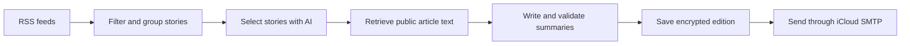

# AI Daily News Digest

A daily AI news briefing that collects RSS stories, selects the most important developments, writes source-grounded summaries, and delivers an HTML email with a plain-text alternative. It runs on GitHub Actions, uses Gemini with a Groq backup, and sends through iCloud SMTP. No always-on computer, website, or custom domain is required.

This public repository contains the working application, tests, implementation prompts, and design references. Production credentials are stored in GitHub Actions secrets; saved delivery state is encrypted before upload. This repository remains the production project—there is no separate public-copy deployment.

## What the digest provides

- **A focused briefing:** selects 10–15 stories when enough relevant, distinct candidates are available, grouped into sections with source links.
- **Article-based summaries:** targets 4–6 sentences and roughly 90–160 words for stories with sufficient accessible evidence. Limited-source stories receive shorter summaries.
- **A topical email subject:** summarizes the day's major topics instead of using only a fixed newsletter title.
- **Readable email design:** a table-based layout with images, black and gray tones, a top gradient, disclosure/footer styling, and a plain-text version. Rendering varies by email client.
- **Resilience:** alternate models, bounded retries, saved prepared editions, encrypted recovery state, and duplicate-send checks.
- **Independent monitoring:** an optional hourly Google Apps Script monitor checks whether GitHub recorded SMTP acceptance.

The styling is inspired by the Apple News email references in [`design/`](design/). This is an independent personal project, not an Apple product.

## How it works



1. **Collect:** read the 13 feeds in [`config.yaml`](config.yaml), including publisher feeds, lab blogs, Google News, Hacker News, and TLDR AI. TLDR issue pages are expanded into individual stories. The configured lookback is 26 hours.
2. **Filter duplicates:** group normalized URL/title matches while preserving source evidence and alternate links. Scheduled editions also compare against accepted story history, retained for 72 hours and bounded to 500 entries by default. Different headlines about the same event may still require the model to merge them.
3. **Select:** the first AI pass ranks candidates, groups related coverage, and returns structured sections and short summaries. Story IDs map back to collected links; model-generated links are not trusted as article destinations.
4. **Retrieve evidence:** resolve supported Google News redirects and extract accessible article text with `trafilatura`. The configured evidence cap is 4,000 characters per article. Login, paywall, and bot-challenge pages are treated as unavailable evidence; the application does not bypass them.
5. **Write:** a second AI pass expands the selected stories using article text and feed snippets. Gemini and Groq share the editorial instructions, grounding constraints, link/ID checks, and paragraph validation. Groq can split the work into paced batches to fit its request budget.
6. **Persist and send:** save the prepared subject, bodies, and delivery metadata, encrypt a recovery artifact, then submit the email through SMTP with STARTTLS. Save encrypted final state and record an SMTP-acceptance receipt after a successful submission.

The main pipeline is in [`digest.py`](digest.py). Scheduling, artifact recovery, and the independent monitor live in separate modules.

## Models, retries, and limitations

The default provider sequence starts with Gemini `gemini-3.5-flash`, then tries `gemini-3.5-flash-lite`, followed by Groq `openai/gpt-oss-120b` when `GROQ_API_KEY` is configured. Bounded primary retries and a final cooldown follow if needed. The model defaults are defined in `digest.py`; local environment overrides and the workflow's optional `GROQ_MODEL` variable are described in the configuration itself.

Current settings allow 60 seconds per model request, a 2-second primary retry backoff, a 15-second final wait, and a 900-second supervised LLM stage cap. The GitHub delivery job has a 20-minute overall timeout. Groq batches share a local token budget and pacing window; provider-wide quotas and usage from other applications can still cause failures.

If selection or rewriting fails, the application can fall back to shorter AI summaries or raw headlines. It labels summary quality in run metadata rather than treating every successful workflow as proof of full AI coverage. If there are no usable feed items, it skips the digest. SMTP or state-recovery failures can fail the run.

AI summaries can contain mistakes. Paywalls, unavailable feeds, provider outages, scheduling delays, and mail filtering remain external dependencies. **SMTP acceptance is not proof of inbox delivery or reading.**

## Daily schedule and duplicate protection

The intended delivery time is **7:50 AM America/Chicago**:

| Component | Role |
| --- | --- |
| cron-job.org | Primary daily trigger: dispatches `daily-digest.yml` with `trigger=external-schedule`. |
| GitHub schedule | Backup UTC firings using `53 12,13,14 * * *` and `23 12,13,14 * * *`. |
| `send_window.py` | Accepts scheduled runs only between 07:45 and 10:00 Chicago time and checks existing `SMTP accepted: YYYY-MM-DD` receipts. |
| Workflow concurrency | Serializes delivery runs within this repository. |

A plain manual dispatch bypasses the scheduled window. Manual runs started before 07:45 do not block the normal morning edition. Do not trigger manual delivery just to check configuration.

Before SMTP submission, the workflow reserves the prepared edition and uploads encrypted state. Subsequent recovery checks distinguish accepted, rejected, and ambiguous attempts. Ambiguous submissions stop for review instead of automatically risking a duplicate. These measures reduce duplicate sends; they do not provide an exactly-once guarantee across SMTP and GitHub outages.

## Security and saved state

- **Credentials:** API keys, SMTP credentials, recipient/sender addresses, and `DIGEST_STATE_KEY` belong in Actions secrets or a private local `.env`, never in tracked files, PRs, screenshots, or logs.
- **Encrypted artifacts:** `state_crypto.py` uses authenticated Fernet encryption. Uploaded delivery-state archives contain only `state.enc`; recovery checks repository, branch, purpose, producing workflow/event, and the permitted file inventory before restoring anything.
- **Retention:** delivery-state artifacts expire after seven days. Keep the encryption key backed up in a password manager; losing it prevents recovery of those artifacts. See [`docs/encrypted-state.md`](docs/encrypted-state.md).
- **Workflow access:** actions use full commit pins, checkout credentials are not persisted, and workflow tokens have explicit read permissions. Push/PR regression tests receive no AI or SMTP secrets.
- **Repository protections:** `main` requires PRs, current **Offline regression tests**, an up-to-date branch, and resolved review conversations. The rule applies to administrators; force pushes and branch deletion are blocked.
- **Public contributions:** outside contributors' workflows require approval. Secret scanning, push protection, Dependabot alerts/security updates, and private vulnerability reporting are enabled in repository settings. These settings are configured separately from the source code.

A public repository exposes tracked files, commit metadata, PRs, and Actions logs. Encryption protects the saved artifact payloads; it does not make the entire repository private or eliminate supply-chain risk. Review workflow and dependency changes before merging, even when tests pass. Do not include private information in a public issue; use the repository's private vulnerability-reporting option for security reports.

Historical audit documents under [`docs/`](docs/) record earlier snapshots and may describe settings that have since changed. They are not a guarantee that every future change is safe.

## Configure your own installation

Use your own repository and accounts. Cloning this project does not copy its GitHub secrets, repository policies, external scheduler, or live Google monitor.

1. Configure a Python 3.13 environment and install [`requirements.txt`](requirements.txt).
2. Add the secrets below under **Settings → Secrets and variables → Actions**. Keep secure copies outside GitHub because saved secret values cannot be displayed again.
3. Configure action permissions and branch protection as described above and in [`CONTRIBUTING.md`](CONTRIBUTING.md).
4. Set up the cron-job.org dispatch and, optionally, the Google monitor. Use separate repository-scoped tokens: **Actions read/write** for the scheduler and **Actions read-only** for the monitor.
5. Review feeds, editorial settings, and display names in `config.yaml`. Configure state encryption before enabling delivery. Migrating an existing installation requires preserving and authenticating its saved state; do not reset it to force a resend.

| Secret | Purpose |
| --- | --- |
| `LLM_API_KEY` | Gemini API access. |
| `GROQ_API_KEY` | Optional Groq backup API access. |
| `SMTP_HOST` | SMTP server; this installation uses `smtp.mail.me.com`. |
| `SMTP_PORT` | STARTTLS port, normally `587`. |
| `SMTP_USER` | SMTP login account. |
| `SMTP_PASSWORD` | Apple app-specific password, not the Apple account password. |
| `EMAIL_TO` | Recipient inbox. |
| `EMAIL_FROM` | Authorized sender address/alias; falls back to `SMTP_USER` when unset. |
| `DIGEST_STATE_KEY` | Fernet artifact-encryption key. |

Provider free tiers and limits can change. The implementation includes retries and pacing, but does not guarantee zero cost or unlimited quota for every account. Public repositories can also have scheduled workflows disabled after prolonged inactivity; check workflow status as part of maintenance.

### External scheduler

Configure cron-job.org for 07:50 in `America/Chicago`, with an HTTP **POST** to:

```text
https://api.github.com/repos/YOUR_OWNER/YOUR_REPO/actions/workflows/daily-digest.yml/dispatches
```

Use `Authorization: Bearer <scheduler-token>`, `Accept: application/vnd.github+json`, and `Content-Type: application/json`, with this body:

```json
{"ref":"main","inputs":{"trigger":"external-schedule"}}
```

Never commit the real token. This is a live delivery trigger, not a harmless connectivity test.

### Independent missing-digest monitor

The optional [`monitoring/`](monitoring/) Google Apps Script project runs hourly and checks the day's SMTP receipt at the first eligible execution after **10:20 Chicago time**. It can alert when no receipt exists or verification fails. It does not inspect your inbox, improve summaries, or resend the digest.

The live project needs its own private Script properties and trigger; repository pushes do not deploy it. Follow [`monitoring/README.md`](monitoring/README.md). `inspectDigest` is a read-only diagnostic. `checkDigest` can send real alerts and should not be run manually during an offline verification. The separate degraded-quality notification helper remains disabled in the current configuration.

## Develop and test without sending email

```sh
python3.13 -m venv .venv
.venv/bin/python -m pip install -r requirements.txt
.venv/bin/python -m unittest discover -s tests -v
node tests/test_google_apps_script.cjs
```

Dependencies are downloaded during installation. The regression checks use mocked services and do not send email or consume model quota.

To render the supplied synthetic fixture without loading credentials, fetching feeds, or calling a model:

```sh
.venv/bin/python digest.py --replay tests/fixtures/replay.json \
  --output /private/tmp/digest-preview.html
```

`--dry-run` avoids sending email but still fetches real feeds and calls AI providers. Plain `python digest.py`, `--send-prepared`, and manual delivery dispatches can send real email. Use them only with explicit authorization. The optional Groq verification scripts also make real API calls; they are not part of offline regression testing.

## Project layout

| Path | Responsibility |
| --- | --- |
| `digest.py` | Feed collection, grouping, evidence retrieval, provider fallback, validation, rendering, and delivery. |
| `config.yaml` | Feeds, evidence/history limits, retry budgets, and email display settings. |
| `send_window.py` | Chicago-time window checks, SMTP receipts, and monitoring helpers. |
| `restore_state.py` | Trusted artifact selection and authenticated state restoration. |
| `state_crypto.py`, `state_maintenance.py` | State encryption and controlled legacy-artifact maintenance. |
| `.github/workflows/` | Daily delivery, offline CI, and manually invoked verification/maintenance. |
| `monitoring/` | Independent Google Apps Script monitor and setup instructions. |
| `tests/` | Regression tests, mocked monitor checks, and synthetic replay fixtures. |
| `scripts/`, `.githooks/` | Exact-commit merge checks and local direct-push protection. |
| `prompts/` | Preserved implementation prompts; not loaded by the runtime. |
| `design/` | Preserved email design references. |
| `docs/` | Encryption, access, and historical audit documentation. |

There is no hosted reader or RSS output service in the current project. Email remains the delivery channel. See [`CONTRIBUTING.md`](CONTRIBUTING.md) for the change-and-review process.
